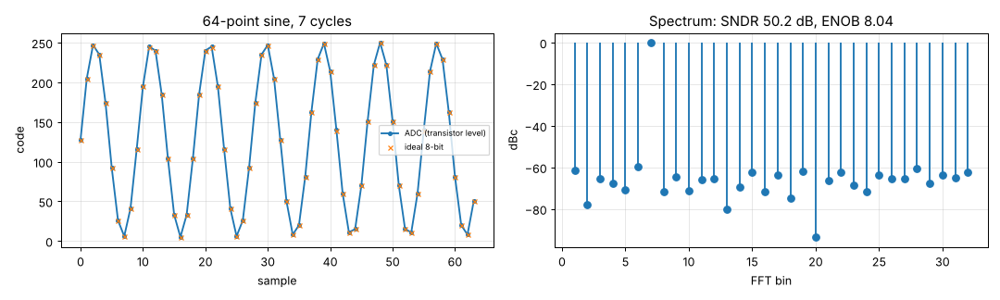

# I2 — 64-point coherent sine (transistor level, tt, 27 °C, 1.8 V, ideal VREF)

Input: 0.6075 V ± 0.58 V, 7 cycles in 64 samples (100 kS/s at 1 MHz clock).

| Quantity | ADC | Ideal 8-bit quantizer, same samples |
|---|---|---|
| SNDR | 50.17 dB | 51.13 dB |
| ENOB | 8.04 bit | 8.20 bit |
| Codes different from the ideal quantizer | 4 of 64 (max 1 LSB) | — |

