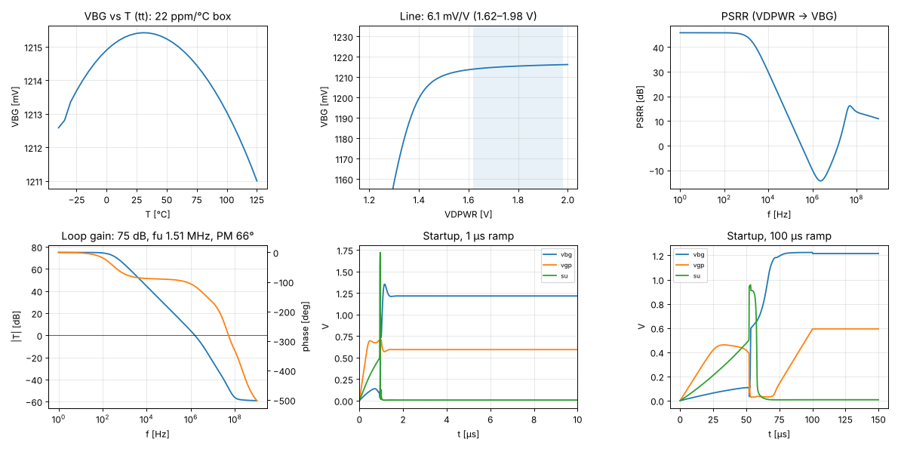

# Stage 3 — bandgap_core results

tt, 27 °C, VDPWR 1.80 V unless noted; biased from `bias_gen`. Generated by `report.py` (`./run.sh`).
Phase-2 rows are early checks at tt only; corners, temperature and supply sweeps across corners follow in Phase 2.

| Spec | Quantity | Result | Target | | Phase |
|---|---|---|---|---|---|
| B1 | VBG | 1.2154 V | 1.21 … 1.29 V (typ 1.25) | ✅ | 1 |
| B2 | Supply current, bandgap_core + bias_gen | 15.7 µA (core 13.6) | ≤ 50 µA | ✅ | 1 |
| B3 | Startup to 1 % after a 1 µs ramp | 0.34 µs after ramp end | ≤ 20 µs | ✅ | 1 |
| — | Startup, 100 µs ramp (rule 7) | settled 0.0 µs after ramp end | starts from 0 V | ✅ | 1 |
| — | Loop gain at DC / crossover | 74.9 dB / 1.51 MHz | — |  | 1 |
| — | Loop phase margin (Middlebrook) | 65.7° | ≥ 60° (stage target) | ✅ | 1 |
| — | OTA input difference vb − va | -56 µV | — |  | 1 |
| — | Startup node su when running | 7.2 mV | MSU1 off | ✅ | 1 |
| B4 | Line regulation 1.62–1.98 V | 6.1 mV/V | ≤ 10 mV/V | ✅ | 2 |
| B5 | Temperature coefficient, −40…125 °C (tt only) | 22.0 ppm/°C | ≤ 50 ppm/°C | ✅ | 2 |
| B7 | PSRR at DC / 1 MHz | 45.8 / -9.8 dB | ≥ 40 / ≥ 20 dB | ❌ | 2 |
| B8 | Power-down current (bandgap_core + bias_gen) | 1.37 nA | ≤ 1 µA | ✅ | 2 |

