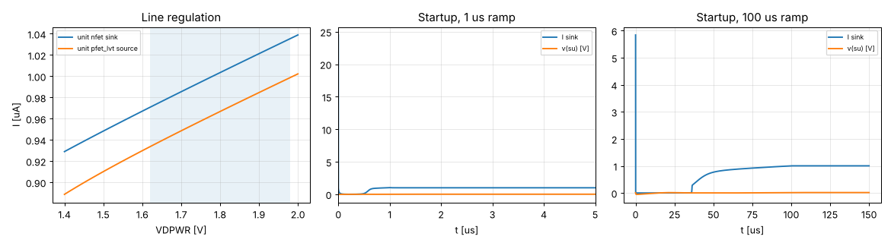

# Stage 1 — bias_gen results

Phase 1: tt, 27 °C, VDPWR 1.80 V (line sweep shown for information).
Generated by `report.py` from `tb_bias.spice`.

| Quantity | Result | Target | |
|---|---|---|---|
| Unit sink current (nfet_01v8 W=2 L=2, Vds 0.9 V) | 1.003 µA | 1 µA | ✅ |
| Unit source current (pfet_01v8_lvt W=2 L=2, Vsd 0.9 V) | 0.967 µA | 1 µA | ✅ |
| bias_gen own supply current | 2.45 µA | — |  |
| Line: sink change over 1.62–1.98 V | 6.4 % | < 10 % (Phase 2 target) | ✅ |
| Sink compliance (95 % of current) | 0.37 V | — |  |
| Power-down supply current | 0.03 nA | — |  |
| Startup, 1 µs ramp: settled to 1 % after ramp end | 0.04 µs | starts from 0 V | ✅ |
| Startup, 100 µs ramp: VDPWR when current reaches 50 % | 0.74 V | starts before VDPWR = 1.62 V | ✅ |
| Startup node v(su) when running | 15 mV | MS1 off | ✅ |

