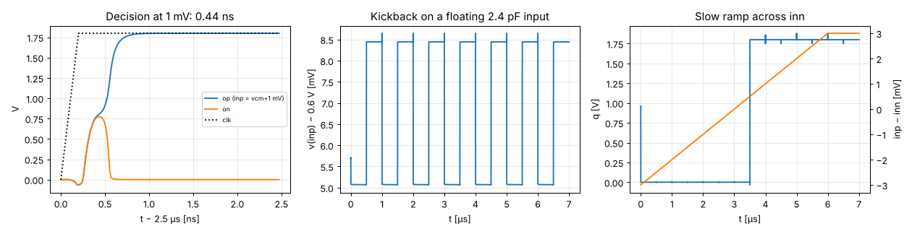

# Stage 6 — comparator results

tt, 27 °C, VDPWR 1.80 V, clk 1 MHz. reltol 1e-5 (see README). Generated by `report.py` (`./run.sh`).

| Spec | Quantity | Result | Target | | Phase |
|---|---|---|---|---|---|
| A10 | Decision time at 1 mV overdrive (clk 50 % → |op−on| > 0.9 V) | 0.44 ns | ≤ 50 ns | ✅ | 1 |
| — | Correct decisions, +1 mV / −1 mV at vcm = 0.6 V | 11/11, 11/11 | all | ✅ | 1 |
| — | Correct decisions ±1 mV at CM 0.2 V and 1.0 V | ok | all | ✅ | 1 |
| — | Kickback: drift of a floating 2.4 pF input over 5 cycles | -0.0 µV | ≤ 0.25 LSB = 1.2 mV | ✅ | 1 |
| — | Kickback: peak excursion during evaluation (returns at reset) | 3.37 mV | — |  | 1 |
| — | Toggle point (slow ramp, inn = 0.6 V) | between -0.50 and +0.50 mV | ≈ 0 (offset at tt) | ✅ | 1 |
| — | Average supply current at 1 MHz clock | 78 nA | — |  | 1 |
| A7 | Offset σ (Monte Carlo) | Phase 2 | ≤ 10 mV |  | 2 |
| A8 | Input-referred noise | Phase 2 | ≤ 1.19 mV rms |  | 2 |

