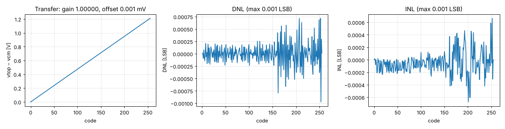

# Stage 8 — cap_dac results

tt, 27 °C, 1.8 V; ideal VREF (1.215 V), vcm and VIN = 0 V; reltol 1e-5. Generated by `report.py`.

| Spec | Quantity | Result | Target | | Phase |
|---|---|---|---|---|---|
| — | Gain (vs ideal VREF/256 per code) / offset | 1.00000 / +0.001 mV | — | | 1 |
| A4 (DAC part) | DNL, all codes (ideal caps) | 0.0010 LSB | ≤ 0.5 LSB | ✅ | 1 |
| A5 (DAC part) | INL, all codes (ideal caps) | 0.0007 LSB | ≤ 1 LSB | ✅ | 1 |
| — | Settling: change between 0.1 µs and 0.55 µs into the hold phase | 1.3 µV | ≤ 0.5 LSB | ✅ | 1 |
| — | Top-plate hold drift over 50 µs (code 127) | -12.7 µV | ≪ 0.5 LSB (slow-clock modes) | ✅ | 1 |
| — | Average VREF current (code sweep, 1 conversion-step per µs) | 0.56 µA | — | | 1 |
| A13 | Mismatch-induced DNL σ (Monte Carlo) | Phase 2 | ≤ 0.25 LSB | | 2 |

