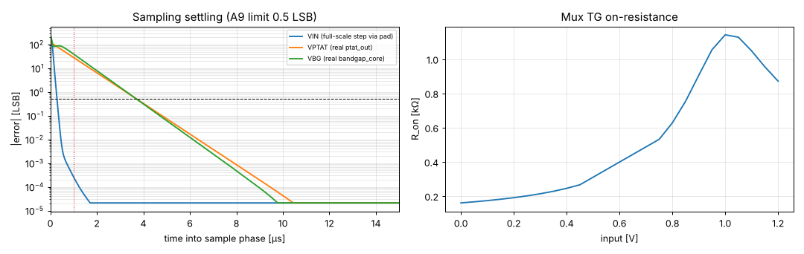

# Stage 7 — inmux + vcm_gen results

tt, 27 °C, VDPWR 1.80 V. Generated by `report.py` (`./run.sh`).

| Spec | Quantity | Result | Target | | Phase |
|---|---|---|---|---|---|
| — | Selection 00/01/10/11 (inputs 0.3 / 0.6 / 1.2 V / VGND) | 0.300 / 0.600 / 1.200 / 0.000m V | follows INSEL | ✅ | 1 |
| — | Mux TG on-resistance, 0 … 1.2 V (excluding ±0.1 V around the 0.6 V test return) | 0.16 … 1.14 kΩ | — | | 1 |
| A14 | DC crosstalk: unselected input 0 → 1.2 V, selected behind 500 Ω | 0.00 µV | ≤ 0.25 LSB = 1.19 mV | ✅ | 1 |
| — | vcm | 0.7162 V | ≈ 0.6–0.75 V (value cancels) | | 1 |
| A9 | Sampling error, VIN (full-scale step via pad): after 1 µs / 10 µs; settles to 0.5 LSB in | -0.001 / +0.0000 mV; 0.29 µs | ≤ 0.5 LSB within 1 µs (1 MHz clock) | ✅ | 1 |
| A9 | Sampling error, VPTAT (real ptat_out): after 1 µs / 10 µs; settles to 0.5 LSB in | +134.405 / +0.0002 mV; 3.72 µs | ≤ 0.5 LSB within 10 µs (≤ 100 kHz clock) | ✅ | 1 |
| A9 | Sampling error, VBG (real bandgap_core): after 1 µs / 10 µs; settles to 0.5 LSB in | -187.789 / -0.0001 mV; 3.71 µs | ≤ 0.5 LSB within 10 µs (≤ 100 kHz clock) | ✅ | 1 |

