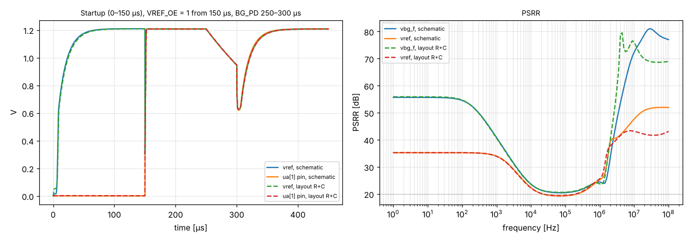

# M1 post-layout results (schematic vs extracted layout)

tt, 27 °C, VDPWR 1.80 V. Generated by `report.py` (`./run.sh`). The same testbenches run on the schematic top level
(`layout/cells/m1_top_ref.spice`) and on the flat R+C extraction of the submission GDS (`layout/m1_pex.py`).
The DUT is driven only through its pins; ua[1] pad model 5 pF + 500 Ω, DMM 10 MΩ ∥ 10 pF.

| Quantity | Schematic | Layout (R+C) | Δ | Target | |
|---|---|---|---|---|---|
| VBG | 1.2105 V | 1.2098 V | -0.7 mV | 1.18–1.25 V (B1) | ✅ |
| vbg_f (filter output) | 1.2105 V | 1.2098 V | -0.7 mV | = VBG |  |
| VREF (internal) | 1.2095 V | 1.2088 V | -0.7 mV | ≈ VBG |  |
| VPTAT | 0.6005 V | 0.6008 V | +0.4 mV | — |  |
| Supply current, normal | 27.95 µA | 27.00 µA | -0.95 | — |  |
| VREF_OE = 1: ua[1] pin, 10 MΩ DMM | 1.2078 V | 1.2071 V | -0.7 mV | VREF − ≤ 2 mV |  |
| VREF_OE = 1: vref | 1.2079 V | 1.2072 V | -0.7 mV | — |  |
| REF_SEL = 1, 1.5 V on ua[1]: vref | 1.5000 V | 1.5000 V | +0.0 mV | 1.5000 V | ✅ |
| REF_SEL = 1: supply current | 18.32 µA | 17.68 µA | -0.64 | buffer off |  |
| BG_PD = 1: supply current (transient, 299 µs) | 0.74 nA | 0.84 nA | +0.10 | ≤ 1000 nA (B8) | ✅ |
| PSRR vbg_f, DC (B7) | 55.7 dB | 55.9 dB | +0.24 | ≥ 40 dB | ✅ |
| PSRR vbg_f, 1 MHz (B7) | 24.5 dB | 23.8 dB | -0.70 | ≥ 20 dB | ✅ |
| PSRR vref, DC | 35.2 dB | 35.3 dB | +0.04 | — |  |
| PSRR vref, 1 MHz | 25.3 dB | 25.6 dB | +0.31 | — |  |
| Startup from 0 V: vref within 1 % | 22.7 µs | 23.9 µs | +1.23 | ≤ 100 µs | ✅ |
| ua[1] pin at 249 µs (VREF_OE from 150 µs) | 1.2078 V | 1.2071 V | -0.7 mV | ≈ VREF |  |
| vref during BG_PD (299 µs) | 0.9506 V | 0.9519 V | +1.3 mV | not driven (CRES holds charge) |  |
| Restart after BG_PD: vref within 1 % | 19.7 µs | 20.9 µs | +1.11 | ≤ 100 µs after 300 µs |  |

Restart time is measured from the release of BG_PD at 300 µs. The power-down current is taken from the
transient: in power-down several nodes float, so the DC operating point is not unique.

## Extraction

```
m1_rc.spice: 1968 R, 1203 C, Nets extracted: 112 (0.612022)
R(pin ua[1] -> devices) = 12.0 Ohm
R(pin ui_in[3] -> devices) = 9.9 Ohm
R(pin ui_in[1] -> devices) = 60.2 Ohm
R(pin uio_in[3] -> devices) = 30.6 Ohm
```


