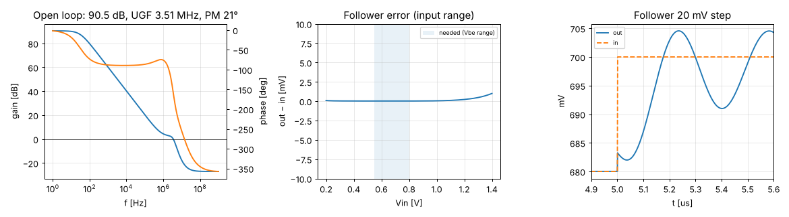

# Stage 2 — ota results

Phase 1: tt, 27 °C, VDPWR 1.80 V, biased from `bias_gen`.
Generated by `report.py` from `tb_ota.spice` and `tb_ota_pd.spice`.

| Quantity | Result | Target | |
|---|---|---|---|
| DC open-loop gain | 90.5 dB | ≥ 50 dB | ✅ |
| Unity-gain frequency (CL = 0.5 pF) | 3.51 MHz | — |  |
| Phase margin (CL = 0.5 pF) | 21.4° | ≥ 60° | ❌ |
| Follower step overshoot (20 mV) | 22.7 % | — |  |
| Follower 10–90 % rise time | 163 ns | — |  |
| Systematic offset (follower at 0.68 V) | 16 µV | — |  |
| Input range, follower error < 1 mV | ≤ 0.20 … 1.40 V | covers 0.55 … 0.80 V | ✅ |
| Supply current (OTA only) | 5.79 µA | — |  |
| Power-down current (OTA only) | 0.03 nA | — |  |
| Input offset σ (Monte Carlo) | Phase 2 | ≤ 2 mV |  |

