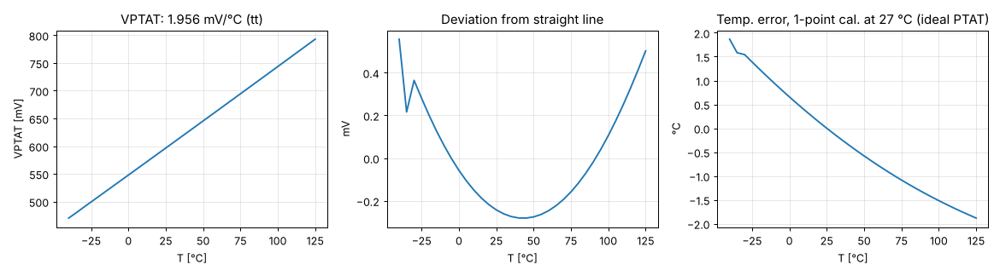

# Stage 4 — ptat_out results

tt corner, VDPWR 1.80 V. Generated by `report.py` (`./run.sh`).

| Spec | Quantity | Result | Target | | Phase |
|---|---|---|---|---|---|
| B10 | VPTAT at 27 °C | 0.6005 V | 0.5 … 0.7 V | ✅ | 1 |
| — | VBG change from adding the branch | -0.014 µV | < 100 µV | ✅ | 1 |
| — | VBG change with vptat loaded by 100 kΩ | 0.008 µV | < 100 µV | ✅ | 1 |
| — | Bandgap loop phase margin with the branch | 69.9° (fu 0.76 MHz) | ≥ 60° | ✅ | 1 |
| B11 | VPTAT slope, −40…125 °C (tt only) | 1.956 mV/°C | ≥ 1.8 mV/°C | ✅ | 2 (early) |
| — | Max deviation from a straight line | 0.56 mV | — |  | 2 (early) |
| B12 | Resolution with the 8-bit ADC (LSB 4.75 mV) | 2.43 °C/LSB | ≤ 2.7 °C/LSB | ✅ | 2 (early) |
| B13 | 1-point (27 °C) calibration error, tt, ideal-PTAT model | 1.88 °C | ≤ ±5 °C | ✅ | 2 (early) |

VPTAT range −40…125 °C: 0.470 … 0.793 V (inside the ADC range 0 … 1.215 V).

