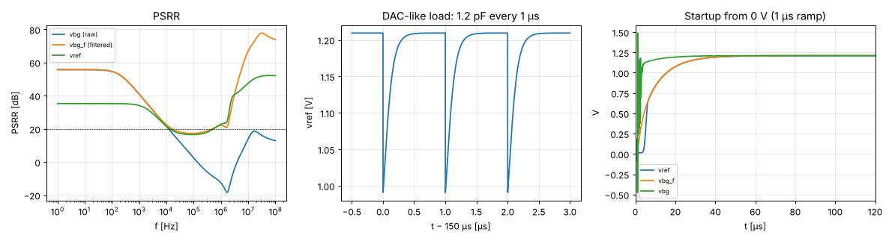

# Stage 5 — VREF chain results (vref_filt, vref_buf, vref_sel)

tt, 27 °C, VDPWR 1.80 V. Pad model: 5 pF + 500 Ω, probe 10 pF ∥ 1 MΩ. Generated by `report.py` (`./run.sh`).

| Spec | Quantity | Result | Target | | Phase |
|---|---|---|---|---|---|
| — | VREF (internal) | 1.2095 V (buffer offset -1.01 mV) | ≈ VBG |  | 1 |
| B7 | PSRR at vbg_f, DC / 1 MHz | 55.7 / 22.2 dB | ≥ 40 / ≥ 20 dB | ✅ | early, tt |
| — | PSRR at vref, DC / 1 MHz | 35.2 / 22.8 dB | — |  | early, tt |
| — | DAC-like load: droop when 1.2 pF connects | 219 mV | — |  | 1 |
| — | DAC-like load: worst error at end of bit cycle | 7.2 µV | ≤ 0.5 LSB = 2.4 mV | ✅ | 1 |
| — | Startup: vref within 1 % (after a 1 µs ramp) | 43.0 µs | ≤ 100 µs (power-up only) | ✅ | 1 |
| — | Follower step (10 mV): overshoot / 10–90 % rise, reservoir only | 0.0 % / 151 ns | stable | ✅ | 1 |
| — | Same, with pad + probe via TG (VREF_OE = 1) | 0.0 % / 589 ns | stable | ✅ | 1 |
| — | Buffer supply current | 9.63 µA | — |  | 1 |
| — | Total (bias_gen + bandgap + VREF chain) | 25.4 µA | — |  | 1 |
| — | Sel A: internal, pad off | vref 1.2139 V, 9.63 µA | buffer on | ✅ | 1 |
| — | Sel B: DMM readout, 1 MΩ probe | vref 1.1986 V, pin 1.1976 V | see note |  | 1 |
| — | Sel C: external 1.5 V on ua[1] | vref 1.5000 V, buffer 0.24 nA | vref = 1.5 V, buffer off | ✅ | 1 |
| — | Sel D: bg_pd = 1 | buffer 0.91 nA | off | ✅ | 1 |

